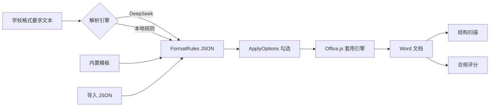

# Architecture

## Pipeline

## Why this split?

- **LLM 不可靠直接改文档**：同一段要求每次生成的 OOXML/操作序列可能不同。
- **Schema 是契约**：解析层可替换（正则 / DeepSeek / 未来别的模型），执行层不变。
- **Mac 降级是一等公民**：探测 `getStyles` / `pageSetup` / `Word.run`，缺失时走段落直接属性，并避免危险页码 OOXML。

## Key modules

| Module | Responsibility |
|--------|----------------|
| `schema.ts` | `FormatRules` / `ApplyOptions` |
| `deepseekParse.ts` | Prompt + JSON merge into schema |
| `applyFormat.ts` | Deterministic Word mutations |
| `documentIntel.ts` | Outline scan + compliance score |
| `officeHost.ts` | Host / API readiness diagnostics |

## Security notes

- API Key stays in browser `localStorage` only.
- Dev proxy `/llm` → `api.deepseek.com` avoids exposing a backend while solving CORS.
- Page-number OOXML auto-insert is disabled by default on Mac to prevent document corruption.
